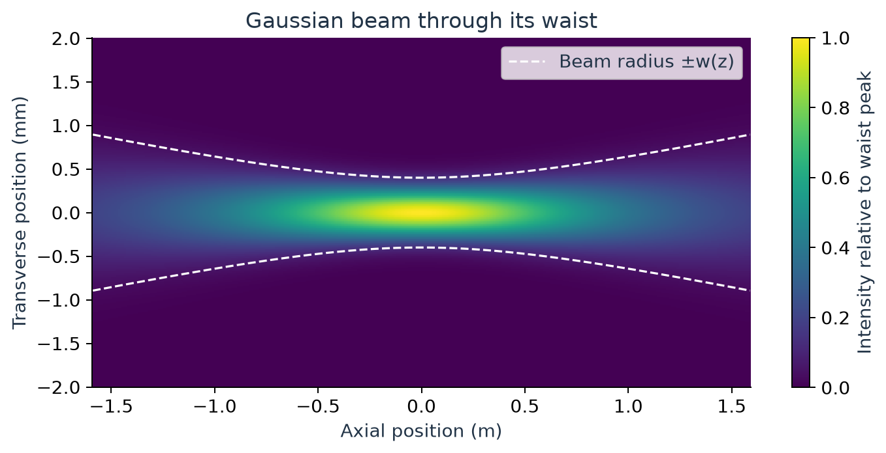
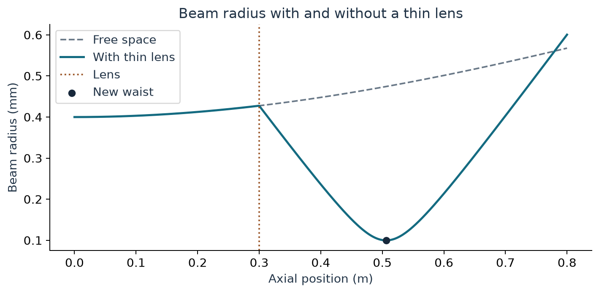
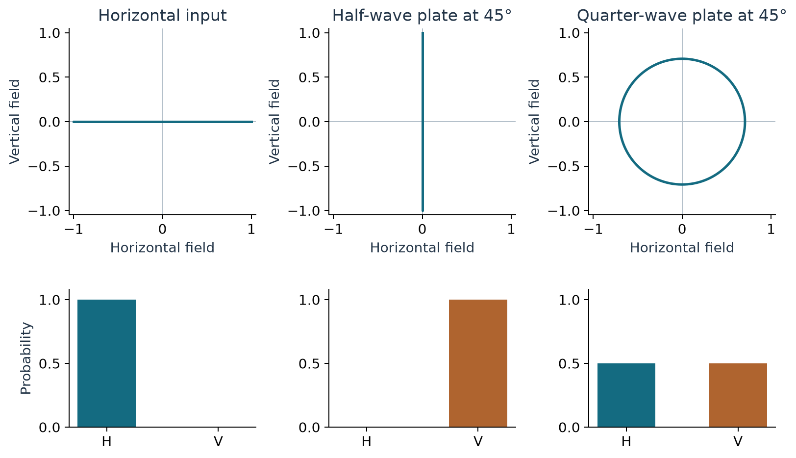

# Photonic Qubit Simulation

A photonic qubit can encode information in two polarization states of light, horizontal and vertical. This project uses a Python notebook to explore two aspects of an ideal optical setup: how a Gaussian beam spreads and focuses, and how wave plates change the polarization that carries the qubit.

The notebook compares free-space propagation with thin-lens focusing, then uses Jones matrices to show how a half-wave plate swaps horizontal and vertical polarization and how a quarter-wave plate turns horizontal input into circular polarization. The plots connect these transformations to the beam radius, the trajectory of the electric field, and the probabilities of measuring horizontal or vertical polarization.

## Results



The beam spreads away from the waist. The dashed curves mark the radius where intensity has fallen to `exp(-2)` of the local peak.



The thin lens changes the wavefront curvature and produces a smaller downstream waist in this example.



At 45°, the half-wave plate swaps horizontal and vertical polarization. The quarter-wave plate turns a horizontal input into circular polarization, giving equal probabilities in the H/V basis.

## Run locally

From the repository root, install the dependencies and launch JupyterLab.

```bash
python -m pip install -r requirements.txt
python -m jupyterlab
```

Open [the notebook](notebooks/photonic_qubit_simulation.ipynb), select a Python 3 kernel, and run all cells. It regenerates the PNGs in `figures/` and checks the free-space radius, radius continuity across the lens, and the polarization transformations.

The model uses illustrative optical parameters, paraxial propagation, an ideal thin lens, and lossless wave plates.

## References

- H. Kogelnik and T. Li, “Laser Beams and Resonators,” *Applied Optics* **5**, 1550–1567 (1966). Gaussian beam propagation and the complex beam parameter. [DOI](https://doi.org/10.1364/AO.5.001550)
- H. Kogelnik, “Imaging of Optical Modes — Resonators with Internal Lenses,” *Bell System Technical Journal* **44**, 455–494 (1965). The ABCD law for Gaussian beams and lenses. [DOI](https://doi.org/10.1002/j.1538-7305.1965.tb01672.x)
- R. C. Jones, “A New Calculus for the Treatment of Optical Systems. I. Description and Discussion of the Calculus,” *Journal of the Optical Society of America* **31**, 488–493 (1941). Jones vectors and matrices for polarization optics. [DOI](https://doi.org/10.1364/JOSA.31.000488)
